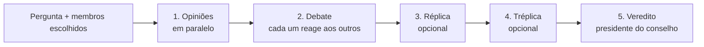

# Konklave

**Convoque um conselho de IAs para debater a sua decisão.**

Você faz uma pergunta difícil e escolhe quem senta à mesa: modelos de IA (Claude, GPT, Gemini, Grok, DeepSeek…), especialistas (o Cético, o Pragmático, o Psicólogo…) e grandes pensadores (Sócrates, Maquiavel, Sun Tzu, Taleb, Buffett…). Eles opinam, rebatem uns aos outros em rodadas e, no fim, um presidente do conselho entrega o veredito.

🔗 **Demo:** [konklave-iota.vercel.app](https://konklave-iota.vercel.app)

<!-- TODO: adicionar um print ou GIF do debate em docs/preview.png -->
<!--  -->

---

## Como funciona



1. **Opiniões:** cada membro responde de forma independente, todos em paralelo.
2. **Debate:** cada membro lê o que os outros disseram e reage.
3. **Réplica e tréplica (opcionais):** rodadas extras para aprofundar os pontos de conflito.
4. **Veredito:** um único modelo, no papel de presidente, consolida o debate em uma recomendação.

Entre as rodadas, uma rota utilitária mede a convergência do grupo, aponta o membro mais divergente e ajuda a eleger o presidente.

## Os 29 membros

| Grupo | Membros |
|---|---|
| **Modelos** (8) | Claude, GPT-4o, Gemini, Grok, Perplexity, DeepSeek, Kimi, Qwen |
| **Especialistas** (7) | Cético, Visionário, Pragmático, Popular, Psicólogo, Historiador, Leigo |
| **Grandes mentes** (14) | Sócrates, Maquiavel, Sun Tzu, Marco Aurélio, Nietzsche, Buda, Jung, Da Vinci, Steve Jobs, Warren Buffett, Eckhart Tolle, Nassim Taleb, Jorge Paulo Lemann, Einstein |

Cada membro tem um system prompt próprio, com estilo de raciocínio, jeito de discordar e **ponto cego declarado**. Assim os debates não viram consenso morno. Ver [`lib/personas.ts`](lib/personas.ts).

## Decisões técnicas

- **Um gateway para todos os modelos:** todas as chamadas passam pelo [OpenRouter](https://openrouter.ai), o que permite misturar provedores sem integrar oito SDKs diferentes.
- **Chamadas paralelas por membro:** cada fase dispara os membros com `Promise.all`, e o frontend mostra cada resposta assim que ela chega, reordenando os cards pela ordem de chegada.
- **Fallback de modelo:** em caso de timeout ou modelo indisponível (404), a chamada é refeita com uma lista de modelos alternativos ([`lib/openrouter.ts`](lib/openrouter.ts)).
- **Modos de velocidade** (`fast`, `normal`, `deep`) ajustam profundidade e custo do debate.
- **Chave de API só no servidor:** a chave nunca chega ao navegador, porque as chamadas de modelo ficam em Route Handlers do Next.js.

## Funcionalidades além do debate

- Cadastro de usuários e controle de uso (Supabase)
- Página de planos
- Exportação do veredito como imagem
- Painel admin com feedbacks, exportação CSV, gráfico de retenção e últimos debates

## Stack

Next.js 16 (App Router) · React 19 · TypeScript · Tailwind CSS 4 · Framer Motion · Supabase · OpenRouter · Vercel

## Rodando localmente

```bash
git clone https://github.com/lekosarmento/konklave.git
cd konklave
npm install
cp .env.example .env.local   # preencha as variáveis abaixo
npm run dev
```

| Variável | Para quê |
|---|---|
| `OPENROUTER_API_KEY` | Chamadas aos modelos |
| `NEXT_PUBLIC_SUPABASE_URL` | URL do projeto Supabase |
| `NEXT_PUBLIC_SUPABASE_ANON_KEY` | Chave pública do Supabase |
| `SUPABASE_SERVICE_ROLE_KEY` | Operações de servidor (cadastro, uso, admin) |
| `ADMIN_PASSWORD` | Acesso ao painel `/admin` |
| `NEXT_PUBLIC_APP_URL` | URL pública do app (usada no header do OpenRouter) |

## Estrutura

```
app/
  api/council/   # uma rota por fase: opinions, debate, replica, treplica, verdict, utility
  api/leads/     # cadastro e controle de uso
  api/admin/     # métricas do painel
  council/       # tela do debate
  admin/         # painel admin
components/council/CouncilApp.tsx   # orquestra as fases no cliente
lib/personas.ts                     # os 29 membros e seus prompts
lib/openrouter.ts                   # cliente OpenRouter com retry e fallback
```

## Próximos passos

- [ ] Streaming das respostas token a token
- [ ] Histórico de sessões por usuário
- [ ] Testes para a orquestração das fases
